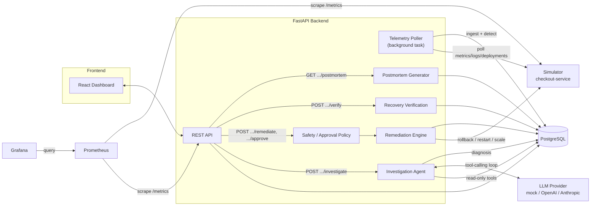
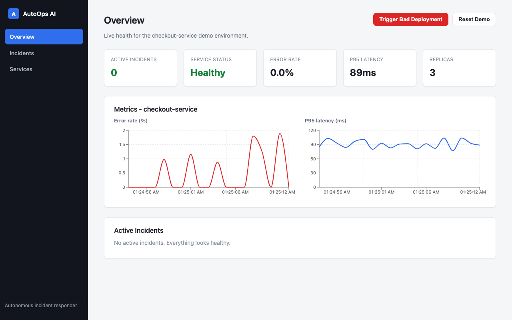
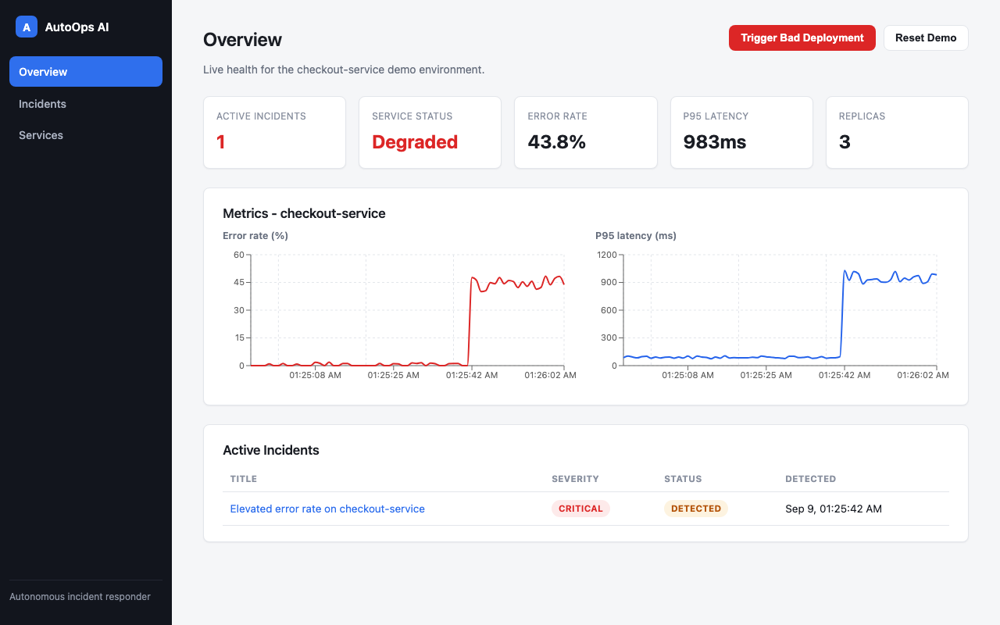
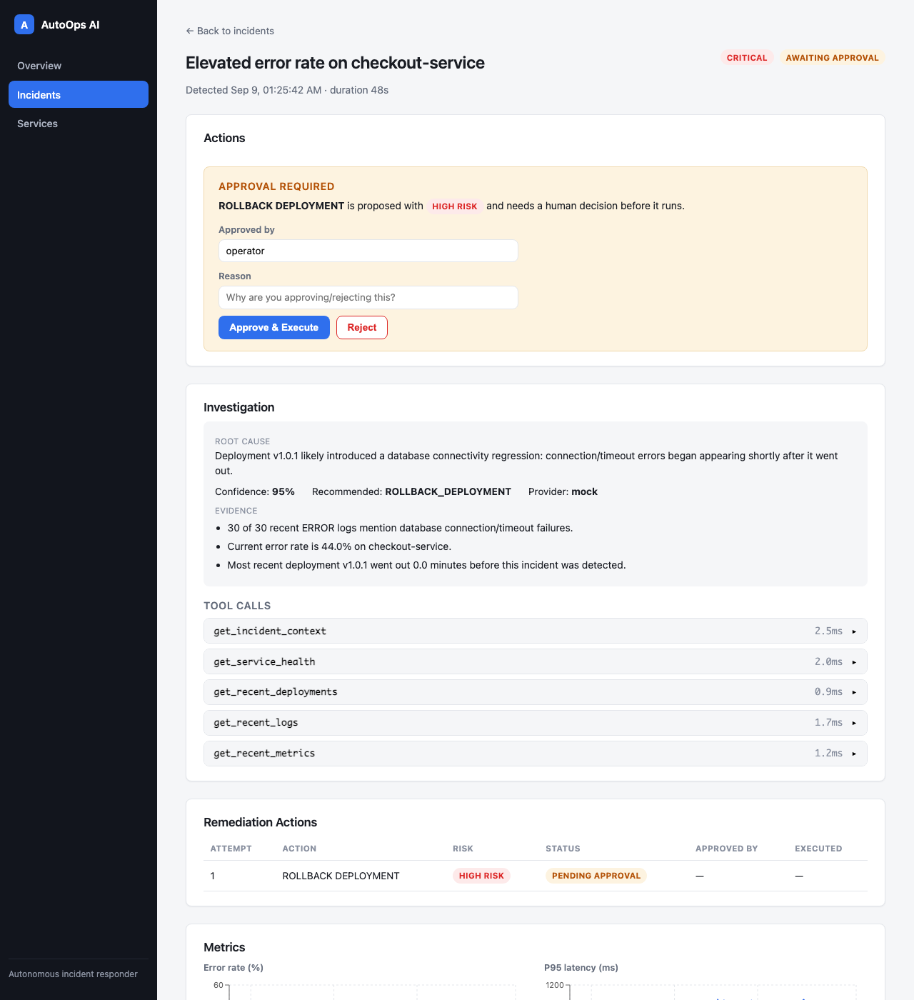
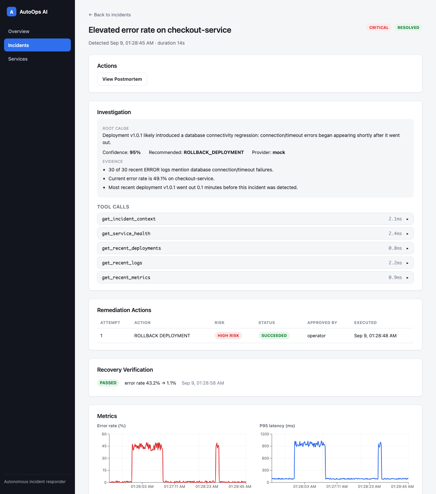
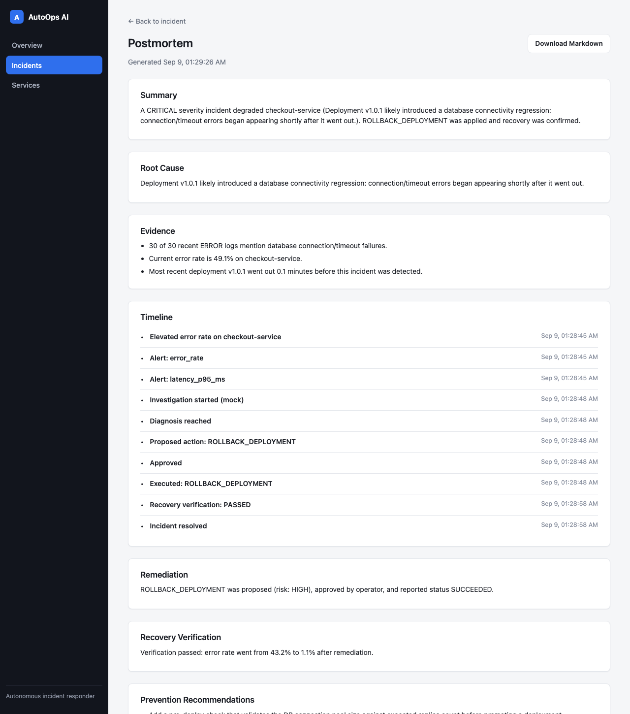
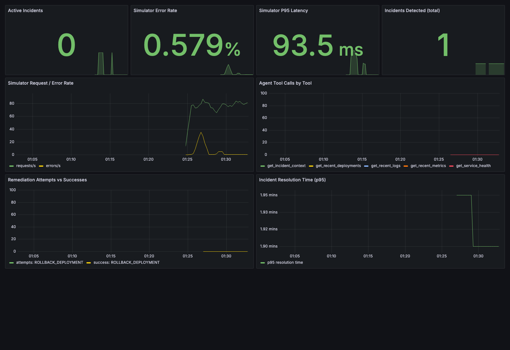

# AutoOps AI

[](https://github.com/Sharon05564/AutoOps-AI/actions/workflows/ci.yml)
[](LICENSE)

**Autonomous production incident responder.** Simulates a bad deployment, detects it from
telemetry, has an LLM-backed agent investigate the real logs/metrics/deployment history to
diagnose the root cause, proposes a remediation gated by a risk-based approval policy, executes it
once approved, verifies the service actually recovered, and writes a postmortem grounded in what
actually happened — not a template.

Nothing here is hardcoded to "know" the answer. The simulator injects a genuinely broken
deployment (a misconfigured database connection pool); the agent has to find that out the same way
an on-call engineer would — by reading logs, metrics, and deployment timing.

## Table of contents

- [The problem](#the-problem)
- [Architecture](#architecture)
- [Demo flow](#demo-flow)
- [Tech stack](#tech-stack)
- [Feature list](#feature-list)
- [Screenshots](#screenshots)
- [Setup](#setup)
- [Environment variables](#environment-variables)
- [Triggering the demo](#triggering-the-demo)
- [API overview](#api-overview)
- [Safety model](#safety-model)
- [Observability](#observability)
- [Testing](#testing)
- [Engineering decisions](#engineering-decisions)
- [Future improvements](#future-improvements)

## The problem

When a deployment breaks production, the usual sequence is: an alert fires, an engineer gets
paged, they open a handful of dashboards, correlate error spikes with the deployment timeline,
form a hypothesis, decide on a fix, get someone to sign off on anything risky, run it, watch the
graphs to confirm it worked, and eventually write up what happened. Most of that is mechanical -
gathering evidence, checking timing correlation, applying a known-safe fix - and it's exactly the
kind of task an LLM with tool access can do well, as long as it's kept on a short leash: it should
never be able to touch production without a real audit trail and, for anything risky, a human
saying yes first.

AutoOps AI builds that whole loop, end to end, against a simulated service so the failure mode is
reproducible on demand.

## Architecture



**Why a separate simulator service instead of faking data in the backend?** The backend treats it
exactly like a real production service: it polls an HTTP API for metrics/logs/deployments and
calls HTTP endpoints to remediate. Swapping the simulator for a real service's metrics/logging
stack wouldn't require touching the backend's core logic.

## Demo flow

1. `checkout-service` is running normally (~1% error rate, ~90ms p95 latency).
2. A "bad deployment" is triggered - the simulator starts rejecting ~45% of requests with database
   connection pool errors and latency climbs to ~1s p95.
3. The telemetry poller (running every 5s) ingests the new metrics/logs, sees the error rate and
   latency both cross their alert thresholds, and creates an `Incident`.
4. The investigation agent is triggered. It calls five read-only tools -
   `get_service_health`, `get_recent_metrics`, `get_recent_logs`, `get_recent_deployments`,
   `get_incident_context` - against the real database, notices the DB-connection error signature in
   the logs correlates with a deployment that went out minutes earlier, and produces a diagnosis:
   root cause, confidence, evidence, and a recommended action (`ROLLBACK_DEPLOYMENT`).
5. Because a rollback is a **HIGH risk** action, it always requires human approval regardless of
   configuration - the incident moves to `AWAITING_APPROVAL`.
6. A human (or, for MEDIUM-risk actions with `SAFE_AUTO_REMEDIATION=true`, the system itself)
   approves it. The remediation engine calls the simulator's rollback endpoint.
7. ~10 seconds later, AutoOps automatically checks whether the service actually recovered by
   comparing metrics from just before the rollback to metrics right now.
8. If the error rate is back under threshold, the incident is marked `RESOLVED`; if not, `FAILED`.
9. A structured postmortem is generated - summary, root cause, evidence, full timeline,
   remediation summary, recovery verification, and prevention recommendations - all built from the
   incident's own recorded data, with only the narrative prose passing through an LLM.

Two details are deliberately baked into the simulator because they matter for judging whether the
agent is reasoning correctly rather than pattern-matching a script: **restarting the service does
not fix this class of failure**, and **scaling up replicas makes it worse** (more pods competing
for the same exhausted connection pool). Only a rollback actually helps.

## Tech stack

| Layer | Choice |
|---|---|
| Frontend | React + TypeScript, Vite, TanStack Query, Recharts, react-router |
| Backend | Python, FastAPI, async SQLAlchemy 2.0, Pydantic v2, Alembic |
| Database | PostgreSQL |
| Agent / LLM | Provider abstraction over OpenAI, Anthropic, and a deterministic mock (no API key needed) |
| Simulator | Standalone FastAPI service |
| Observability | Prometheus + Grafana (auto-provisioned) |
| Containerization | Docker + Docker Compose |
| Testing | pytest (backend, DB-backed), Vitest (frontend) |
| CI | GitHub Actions |

## Feature list

- Realistic failure simulation with a background traffic generator and a bad-deployment injector
- Automatic telemetry ingestion and threshold-based incident detection (with alert dedup)
- An investigation agent that calls real tools over real data - no hardcoded diagnosis
- Pluggable LLM provider (mock / OpenAI / Anthropic) behind one interface
- Risk-based safety policy: HIGH-risk actions always need approval; MEDIUM is configurable
- Idempotent remediation proposals and a hard cap on remediation attempts per incident
- Full audit trail: every tool call and every remediation action/approval is a database row
- Automatic recovery verification comparing real before/after metrics
- AI-assisted postmortem generation, with a downloadable Markdown report
- A 5-page React dashboard: Overview, Incidents, Incident Detail, Services, Postmortem
- Custom Prometheus metrics wired into the actual lifecycle code, with an auto-provisioned Grafana
  dashboard
- 47 backend tests, including a full end-to-end integration test of the entire pipeline

## Screenshots

**Overview — healthy baseline**


**Overview — after triggering the bad deployment**


**Incident detail — diagnosis, evidence, and the approval gate**


**Incident detail — after remediation and automatic recovery verification**


**Generated postmortem**


**Grafana dashboard — real metrics from the run above**


## Setup

**Requirements:** Docker + Docker Compose. That's it - the mock LLM provider means no API key is
required to run the full demo.

```bash
git clone <this-repo-url>
cd autoops-ai
cp .env.example .env
docker compose up -d --build
```

This starts Postgres, the simulator, the backend (running Alembic migrations automatically on
startup), the frontend, Prometheus, and Grafana.

| Service | URL |
|---|---|
| Dashboard | http://localhost:5173 |
| Backend API docs | http://localhost:8000/docs |
| Simulator | http://localhost:9000 |
| Prometheus | http://localhost:9090 |
| Grafana | http://localhost:3001 (admin / admin, see `GRAFANA_ADMIN_PASSWORD`) |

To run the backend or frontend outside Docker for development, see `Makefile` for the individual
commands each container runs, or `CONTRIBUTING.md`.

## Environment variables

All variables live in `.env.example` with sane defaults - copy it to `.env` and the stack runs
as-is. The ones worth knowing about:

| Variable | Default | Purpose |
|---|---|---|
| `LLM_PROVIDER` | `mock` | `mock`, `openai`, or `anthropic`. Mock needs no API key and still runs the real tool-calling loop over real data. |
| `OPENAI_API_KEY` / `ANTHROPIC_API_KEY` | _(empty)_ | Required only if you switch `LLM_PROVIDER`. |
| `SAFE_AUTO_REMEDIATION` | `false` | When `true`, MEDIUM-risk actions (restart, scale) execute without approval. HIGH-risk (rollback) always requires approval regardless of this flag. |
| `MAX_REMEDIATION_ATTEMPTS_PER_INCIDENT` | `3` | Hard cap to prevent remediation retry loops. |
| `TELEMETRY_POLL_INTERVAL_SECONDS` | `5` | How often the backend polls the simulator. |
| `ERROR_RATE_ALERT_THRESHOLD` | `0.15` | Error rate above this triggers an alert/incident. |
| `LATENCY_ALERT_THRESHOLD_MS` | `800` | P95 latency above this triggers an alert/incident. |
| `SLACK_WEBHOOK_URL` | _(empty)_ | Optional - not currently wired to a notifier, reserved for that extension. |

See `.env.example` for the complete list (database credentials, ports, CORS origins).

## Triggering the demo

From the dashboard: open http://localhost:5173, click **Trigger Bad Deployment** on the Overview
page, then work through the incident from the Incidents page as it appears (Investigate → propose
remediation → approve). Everything after that (verification, postmortem) happens automatically or
via the buttons on the incident detail page.

From the command line:

```bash
# Trigger the bad deployment
curl -X POST http://localhost:8000/api/simulator/deployments/bad

# Wait a few seconds for telemetry to detect it, then find the incident
curl http://localhost:8000/api/incidents | python3 -m json.tool

# Investigate (replace INCIDENT_ID)
curl -X POST http://localhost:8000/api/incidents/INCIDENT_ID/investigate

# Propose remediation (defaults to the investigation's recommended action)
curl -X POST http://localhost:8000/api/incidents/INCIDENT_ID/remediate

# Approve it (rollback is HIGH risk, so this step is required)
curl -X POST http://localhost:8000/api/incidents/INCIDENT_ID/approve \
  -H "Content-Type: application/json" \
  -d '{"approved": true, "approved_by": "you", "reason": "confirmed safe"}'

# After ~10s, recovery is auto-verified. Check the result:
curl http://localhost:8000/api/incidents/INCIDENT_ID | python3 -m json.tool

# Read the generated postmortem
curl http://localhost:8000/api/incidents/INCIDENT_ID/postmortem/markdown

# Reset the demo back to a clean, healthy baseline
curl -X POST http://localhost:8000/api/simulator/reset
```

## API overview

| Method | Path | Purpose |
|---|---|---|
| GET | `/health` | Liveness check |
| GET | `/metrics` | Prometheus scrape endpoint |
| GET | `/api/services` | Service health summary (error rate, latency, active incidents) |
| GET | `/api/services/{id}` | Single service's health |
| GET | `/api/services/{id}/metrics` | Historical metric snapshots for charts |
| GET | `/api/services/{id}/logs` | Recent log entries |
| GET | `/api/incidents` | List incidents, optional `?status=` filter |
| GET | `/api/incidents/{id}` | Full incident detail (alerts, investigations, remediations, verifications) |
| GET | `/api/incidents/{id}/timeline` | Chronological event feed for the incident |
| POST | `/api/incidents/{id}/investigate` | Run the investigation agent |
| POST | `/api/incidents/{id}/remediate` | Propose a remediation action (idempotent) |
| POST | `/api/incidents/{id}/approve` | Approve or reject a pending remediation |
| POST | `/api/incidents/{id}/verify` | Manually re-check recovery (also runs automatically) |
| GET | `/api/incidents/{id}/postmortem` | Generate/fetch the postmortem (JSON) |
| GET | `/api/incidents/{id}/postmortem/markdown` | Same report as downloadable Markdown |
| GET | `/api/deployments` | Deployment history, optional `?service_id=` filter |
| POST | `/api/simulator/deployments/bad` | Trigger the bad-deployment scenario |
| POST | `/api/simulator/reset` | Reset the simulator and wipe incident history |

Full interactive docs (request/response schemas) are at `/docs` when the backend is running.

## Safety model

- **Tools are split into two hard categories.** Read-only tools (`get_service_health`,
  `get_recent_metrics`, `get_recent_logs`, `get_recent_deployments`, `get_incident_context`) are
  the only ones ever exposed to the LLM's tool-calling loop, and they only ever query the
  database - never the simulator, never a shell. Mutating tools
  (`rollback_deployment`, `restart_service`, `scale_service`) are implemented separately and are
  never given to the LLM; they're only ever invoked by the remediation engine after the policy
  clears them.
- **Every mutating action has a risk level.** `ROLLBACK_DEPLOYMENT` is HIGH and always requires
  approval. `RESTART_SERVICE` and `SCALE_SERVICE` are MEDIUM, gated by `SAFE_AUTO_REMEDIATION`.
- **Every action is audited.** Every tool call becomes an `AgentToolCall` row; every remediation
  attempt becomes a `RemediationAction` row; every approval decision (who, when, why) becomes an
  `Approval` row.
- **Idempotent by construction.** A second call to `/remediate` while one action is already
  pending/approved/executing returns the existing action instead of creating a duplicate.
- **Remediation loops are capped.** `MAX_REMEDIATION_ATTEMPTS_PER_INCIDENT` stops an incident from
  being retried forever; once exceeded, the incident is marked `FAILED`.
- **The LLM never executes anything.** It can only return a `recommended_action` string in its
  diagnosis. Turning that into an actual API call always goes through the policy layer above.

## Observability

Six custom Prometheus metrics are wired directly into the lifecycle code where those events
already happen (not a bolted-on logging layer):

`autoops_incidents_total`, `autoops_active_incidents`, `autoops_agent_tool_calls_total`,
`autoops_remediation_attempts_total`, `autoops_remediation_success_total`,
`autoops_incident_resolution_seconds` - plus the simulator's own `simulator_request_total`,
`simulator_error_total`, and `simulator_request_latency_seconds`.

An 8-panel Grafana dashboard is provisioned automatically via Docker Compose (no manual
import) at http://localhost:3001. Prometheus and Grafana's config is baked into their images at
build time rather than bind-mounted from the host - see
[Engineering decisions](#engineering-decisions) for why.

## Testing

```bash
cd backend
docker compose up -d postgres   # tests need a real Postgres - UUID/JSON columns aren't SQLite-compatible
python -m venv .venv && source .venv/bin/activate
pip install -r requirements.txt
alembic upgrade head
pytest -v
```

47 tests, all passing:
- Pure-unit tests for the safety policy, alert severity classification, mock provider reasoning,
  telemetry dedup logic, and postmortem markdown rendering.
- Real Postgres-backed integration tests for incident lifecycle, remediation safety (approval
  requirements, idempotency, the max-attempts guard), and recovery verification.
- API-level tests using httpx's `ASGITransport` directly against the FastAPI app (no server
  process, no live simulator needed for most endpoints).
- One full end-to-end test driving the entire pipeline through the API: bad deployment → alert →
  incident → investigation → diagnosis → approval → rollback → verification → resolved →
  postmortem, asserting on real values at every step.

Frontend: `cd frontend && npm run test` (Vitest, currently covering the formatting utilities).

## Engineering decisions

A few choices worth explaining, since they were deliberate trade-offs rather than defaults:

- **Plain SQLAlchemy models + separate Pydantic schemas, not SQLModel.** More boilerplate, but a
  clean line between the persistence layer and the API contract - changing one doesn't force
  changing the other, and it's the pattern most production FastAPI codebases actually use.
- **The mock LLM provider still runs the real tool-calling loop.** It calls the same five
  read-only tools, over the same real database, as the OpenAI/Anthropic providers would - it just
  replaces the "brain" that decides which tools to call and how to interpret the results with
  deterministic rules (log-pattern matching + deployment-timing correlation). The diagnosis is
  never hardcoded to the scenario; it's derived from whatever the tools actually return.
- **Deployment config for Prometheus/Grafana is baked into custom images, not bind-mounted.**
  Bind-mounting `prometheus.yml` and Grafana's provisioning directory from the host hit a Docker
  Desktop virtiofs bug on macOS ("resource deadlock avoided") that crash-looped both containers.
  Baking config into the image at build time sidesteps host-filesystem-sharing quirks entirely and
  is arguably the more production-realistic choice anyway.
- **Simulator state lives in memory, not its own database.** It's a traffic/failure generator, not
  a system of record - the backend's Postgres database is the actual source of truth for
  everything that matters (metrics history, logs, incidents). Keeping the simulator stateless-ish
  keeps `docker compose down && up` demo resets simple.
- **Alembic migrations are hand-written, not autogenerated**, for the initial schema (there was no
  live database available when it was authored). Verified by running upgrade → downgrade →
  re-upgrade against a real Postgres instance before trusting it.
- **The investigation agent never sees `is_bad_deployment`.** That field exists in the database
  (the simulator's ground truth for scenario purposes) but every read-only tool deliberately
  omits it from its output. The agent - mock or real LLM - has to infer the root cause from the
  same observable symptoms (log content, deployment timing, error rate) a human would use, not
  read an answer key.

## Future improvements

- Slack/Discord notification on incident detection and resolution (webhook URL is already in
  config, just not wired to a notifier yet)
- Multi-service support (the data model already supports it; the simulator only models one)
- A real authentication layer for approvals (`approved_by` is currently free-text)
- Streaming the investigation agent's tool calls to the frontend in real time instead of polling
- Historical trend dashboards (MTTR over time, incident frequency by root-cause category)
- Canary-based automated rollback as a fourth remediation action type

## License

MIT - see `LICENSE`.
